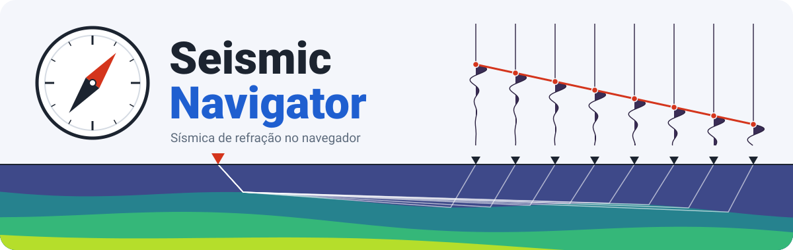

<p align="center">
  
</p>

# Seismic Navigator

Processamento de **sísmica de refração direto no navegador**: abra os arquivos dos tiros, marque as primeiras chegadas e inverta os tempos para obter o modelo de velocidade da onda P em subsuperfície.

**Abra e use: <https://allanspadini.github.io/seismic-navigator/>**

Não há instalação nem servidor. Os arquivos são lidos e processados no seu computador e **não são enviados a lugar nenhum**.

## O que dá para fazer

1. **Abrir os tiros** em SEG-2 (`.dat`, `.sg2`, `.seg2`) ou SEG-Y (`.sgy`, `.segy`), vários de uma vez. O formato é reconhecido pelo conteúdo, não pela extensão.
2. **Conferir a geometria**: posição da fonte e dos geofones, com correção manual quando o cabeçalho vem vazio ou errado, e topografia opcional.
3. **Marcar as primeiras chegadas** no sismograma em wiggle, à mão ou com o picking automático como ponto de partida.
4. **Controlar a qualidade** nas curvas tempo–distância de todos os tiros juntos.
5. **Inverter** os tempos por tomografia e ver o modelo de Vp com os raios e a cobertura.
6. **Exportar** os picks (CSV), o modelo (CSV e PNG) e o projeto (JSON) para continuar depois.

## Como usar

Abra a página, clique em **Abrir arquivos de dados** (ou arraste os arquivos para a janela) e siga as abas **Picking → Tempo–distância → Inversão**.

No sismograma:

| Ação | Como |
| --- | --- |
| Marcar um pick | clique no traço |
| Marcar vários de uma vez | clique e arraste sobre os traços |
| Apagar um pick | botão direito, ou Ctrl+clique |
| Aproximar o tempo | roda do mouse |
| Deslocar o tempo | Shift + roda do mouse |
| Trocar de tiro | ↑ e ↓ |
| Desfazer | Ctrl+Z |

O **projeto** (`.json`) guarda geometria, picks e parâmetros da inversão, mas não os traços. Para retomar um trabalho, abra primeiro os arquivos de dados e depois o projeto; os tiros são reconhecidos pelo nome do arquivo.

## Dados de exemplo

Quer experimentar e não tem dados à mão?

- Na página inicial, **Carregar exemplo sintético** gera um levantamento com 7 tiros e 24 geofones.
- O repositório [**graphSEG2**](https://github.com/tonianr/graphSEG2), de Tonian Robinson, é um ótimo lugar para pegar arquivos reais: traz levantamentos de refração em SEG-2 gravados com sismógrafo Geometrics. A pasta `exampledata_FGSeismic2019` tem uma linha completa de 9 tiros (`101.dat` a `109.dat`) que abre direto aqui. O graphSEG2 também inspirou o estilo do sismograma em wiggle desta ferramenta.

## Como funciona a inversão

- **Modelagem direta**: tempos de primeira chegada pelo método do caminho mínimo em uma malha regular que respeita a topografia.
- **Inversão**: tomografia de tempos de trânsito, iterativa, regularizada por suavidade e com pesos robustos que reduzem o efeito de picks discrepantes.
- **Modelo inicial**: velocidade crescendo linearmente com a profundidade; os valores são sugeridos a partir dos picks e podem ser editados.

O resultado mostra o desajuste RMS, o resíduo mediano, os tempos calculados sobre os observados e os raios. A parte do modelo abaixo do raio mais profundo aparece esmaecida: ali não há dado, só extrapolação.

## Limitações

- O picking automático é um auxílio e erra alguns traços em dados reais. Revise sempre antes de inverter.
- A leitura de SEG-Y foi testada apenas com arquivos sintéticos; a de SEG-2, também com arquivos reais da Geometrics.
- Interfaces bruscas de velocidade saem suavizadas no modelo.
- A sessão não é salva automaticamente: salve o projeto antes de fechar a aba.

## Desenvolvimento

Requer [Node.js](https://nodejs.org/) 20 ou mais recente.

```bash
npm install
npm run dev        # servidor local em http://localhost:5173
npm test           # testes unitários
npm run build      # checagem de tipos e build em dist/
```

É TypeScript com [Vite](https://vite.dev/), sem framework de interface e sem dependências em tempo de execução. Os parsers e o núcleo numérico ficam em `src/io` e `src/core`, separados da interface em `src/ui`. O arquivo [CLAUDE.md](CLAUDE.md) descreve a arquitetura e as convenções.

### Publicação

O workflow em [.github/workflows/deploy.yml](.github/workflows/deploy.yml) roda os testes, faz o build e publica no GitHub Pages a cada push na `main`. No repositório, escolha **GitHub Actions** como fonte em *Settings → Pages*.

## Licença

[MIT](LICENSE).
